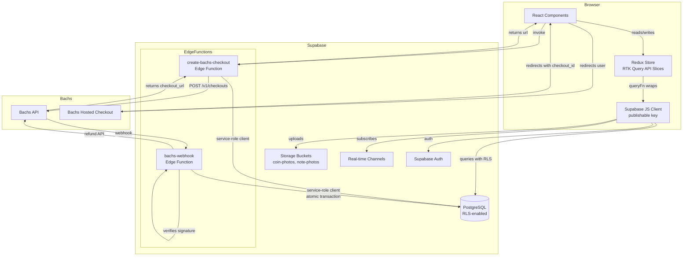
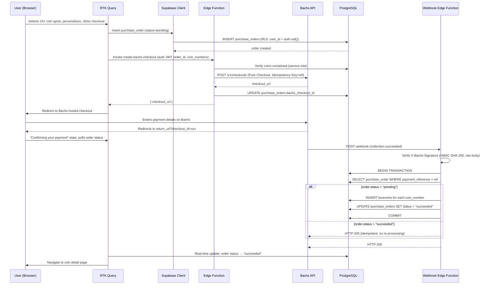
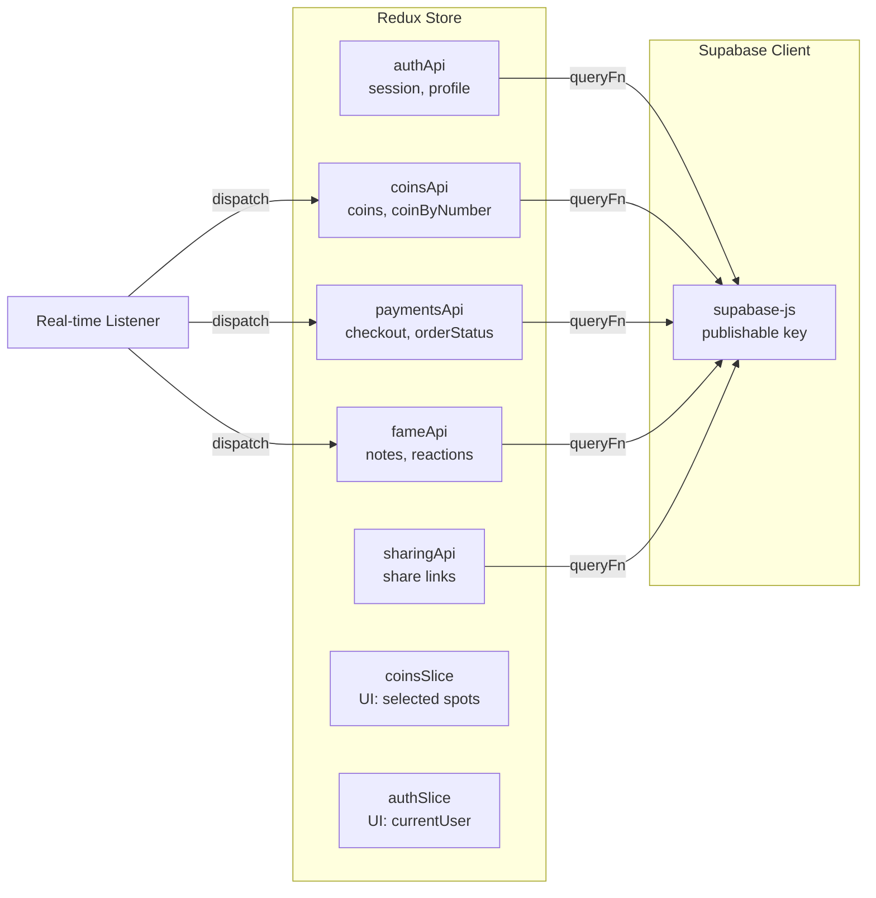

# Design Document: Supabase Backend Integration

## Overview

This design covers the full integration of the LoveCoin app with its Supabase backend, replacing the mock payment flow, base64 image storage, and context-based state management with production-grade infrastructure: Supabase Storage for images, Bachs hosted checkout for payments, Supabase Edge Functions for server-side payment processing, real-time subscriptions for live updates, and Redux Toolkit + RTK Query as the centralized data layer.

The current app uses a `LoveProvider` React context that wraps all Supabase calls directly in components, stores images as base64 data URLs in the database, and processes payments through a mock `chargeCard` function. This design replaces that with a layered architecture where RTK Query API slices own all server communication, Edge Functions handle privileged operations, RLS policies enforce authorization, and the two-phase claim flow ensures no coin is granted without a verified payment.

### Key Design Decisions

| Decision | Rationale |
|---|---|
| Bachs Pure Checkout (not product-based) | The total amount depends on the number of coin spots selected at runtime; no pre-created Bachs products needed. |
| Two-phase claim flow | Client creates a pending `purchase_order`, then an Edge Function inserts coins only after webhook-verified payment. Prevents coin theft via redirect manipulation. |
| RTK Query over React Query | User's explicit choice; the code guide requires RTK Query. Provides tag-based cache invalidation and centralized server state. |
| Service-role key only in Edge Functions | Never exposed to the browser. All privileged writes (coin insertion, webhook processing) happen server-side. |
| HMAC SHA-256 webhook verification | Bachs signs webhooks with `X-Bachs-Timestamp` and `X-Bachs-Signature`. The Edge Function verifies the raw body before any database write. |
| `payment_reference` as idempotency key | Used for both the Bachs `Idempotency-Key` header and the unique constraint on `purchase_orders`, ensuring retries don't create duplicates. |
| User-prefixed storage paths | `auth.uid()/timestamp-filename` prevents filename collisions and enables RLS enforcement on upload paths. |

---

## Architecture

### High-Level Architecture



### Two-Phase Claim Flow



### Data Layer Architecture (RTK Query)



---

## Components and Interfaces

### RTK Query API Slices

#### authApi (`features/auth/api/authApi.ts`)

```typescript
interface AuthApi {
  // Endpoints
  getSession: Query<Session | null, void>;
  getProfile: Query<Profile | null, string>; // userId
  updateDisplayName: Mutation<Profile, { displayName: string }>;
  signInWithGoogle: Mutation<void, { redirectTo: string }>;
  signInWithEmail: Mutation<void, { email: string; password: string }>;
  signUpWithEmail: Mutation<void, { email: string; password: string; displayName: string }>;
  signOut: Mutation<void, void>;
}
// Tag types: "Profile", "Session"
```

#### coinsApi (`features/coins/api/coinsApi.ts`)

```typescript
interface CoinsApi {
  // Endpoints
  getCoins: Query<CoinSummary[], { limit?: number; offset?: number }>;
  // Returns only: coin_number, style, owner_id (for HeartGrid rendering)
  getCoinByNumber: Query<LoveCoin, number>;
  getMyCoins: Query<LoveCoin[], void>;
  getReceivedCoins: Query<LoveCoin[], void>;
  // Upload image to Storage, return public URL
  uploadCoinPhoto: Mutation<string, { file: File; userId: string }>;
}
// Tag types: "Coins", "Coin", "MyCoins", "ReceivedCoins"
```

#### paymentsApi (`features/payments/api/paymentsApi.ts`)

```typescript
interface PaymentsApi {
  // Endpoints
  createPurchaseOrder: Mutation<PurchaseOrder, {
    coinNumbers: number[];
    totalAmountKobo: number;
    paymentReference: string;
  }>;
  // Invoke Edge Function to create Bachs checkout session
  createBachsCheckout: Mutation<{ checkoutUrl: string }, {
    orderId: string;
    paymentReference: string;
    totalAmountKobo: number;
    coinNumbers: number[];
  }>;
  // Poll order status after redirect
  getOrderStatus: Query<PurchaseOrder, string>; // orderId
  cancelPurchaseOrder: Mutation<void, string>; // orderId
}
// Tag types: "PurchaseOrder"
```

#### fameApi (`features/fame/api/fameApi.ts`)

```typescript
interface FameApi {
  // Endpoints
  getNotes: Query<LoveNote[], { limit?: number; offset?: number }>;
  getReactions: Query<ReactionRow[], void>;
  publishNote: Mutation<LoveNote, {
    content: string;
    loveType: LoveType;
    category: NoteCategory;
    imageFile?: File;
    loveCoinId?: string;
  }>;
  toggleReaction: Mutation<void, { noteId: string; reactionType: ReactionType }>;
  uploadNotePhoto: Mutation<string, { file: File; userId: string }>;
}
// Tag types: "Notes", "Reactions"
```

#### sharingApi (`features/sharing/api/sharingApi.ts`)

```typescript
interface SharingApi {
  // Endpoints
  getShareableCoin: Query<LoveCoin, number>;
  // Generate share link
  createShareLink: Mutation<string, { coinNumber: number }>;
}
// Tag types: "Coin"
```

### RTK Slices (UI State Only)

#### coinsSlice (`features/coins/slices/coinsSlice.ts`)

```typescript
interface CoinsUIState {
  selectedCoinNumbers: number[];
  isClaimFlowOpen: boolean;
}
// Actions: toggleCoinSelection, clearSelection, openClaimFlow, closeClaimFlow
```

#### authSlice (`features/auth/slices/authSlice.ts`)

```typescript
interface AuthUIState {
  currentUser: { id: string; displayName: string; email: string | null } | null;
  sessionExpired: boolean;
}
// Actions: setCurrentUser, clearSession, markSessionExpired
```

### Supabase Edge Functions

#### create-bachs-checkout (`supabase/functions/create-bachs-checkout/index.ts`)

**Responsibility**: Create a Bachs Pure Checkout session for a pending purchase order.

**Input** (POST JSON body, authenticated via Supabase Auth JWT in `Authorization` header):
```typescript
{
  orderId: string;        // UUID of the purchase_order
  paymentReference: string;
  totalAmountKobo: number;
  coinNumbers: number[];
}
```

**Process**:
1. Verify the caller's JWT from the `Authorization` header using the Supabase client.
2. Load the purchase_order by `orderId` using the service-role client. Verify `user_id` matches the caller and `status` is "pending".
3. Verify all `coinNumbers` are currently unclaimed (no lovecoins row with that `coin_number`).
4. Call Bachs API `POST /v1/checkouts` with:
   - `amount`: total in kobo as a decimal string (e.g., "1000.00" for ₦1000)
   - `currency`: "NGN"
   - `customer_email`: caller's email
   - `reference`: `paymentReference`
   - `metadata`: `{ user_id, coin_numbers, order_id }`
   - `success_url` / `cancel_url`: configured return/cancel URLs
   - `Idempotency-Key` header: `paymentReference`
5. Update `purchase_orders.bachs_checkout_id` with the returned `checkout_id`.
6. Return `{ checkoutUrl: session.checkout_url }` to the client.

**Error responses**: 401 (unauthenticated), 403 (order doesn't belong to user or not pending), 409 (coin already claimed), 500 (Bachs API error).

#### bachs-webhook (`supabase/functions/bachs-webhook/index.ts`)

**Responsibility**: Receive and verify Bachs webhook events, insert LoveCoin records atomically.

**Input**: Raw HTTP POST body with `X-Bachs-Timestamp` and `X-Bachs-Signature` headers.

**Process**:
1. Read the **exact raw request body** (before any JSON parsing).
2. Verify the `X-Bachs-Signature` header using HMAC SHA-256 with `BACHS_WEBHOOK_SECRET`. Check the timestamp is within the tolerance window (default 300 seconds).
3. If verification fails, return HTTP 401.
4. Parse the event body. Extract `event.type`, `event.data.reference`, and `event.data.metadata`.
5. Look up the `purchase_order` by `payment_reference` (from `event.data.reference` or metadata).
6. **Idempotency check**: If the order status is already "succeeded" or "failed", return HTTP 200 without re-processing.
7. If no matching order is found, log the discrepancy and return HTTP 200 (prevents retries).
8. For `collection.succeeded`:
   - Begin a database transaction.
   - Attempt to insert LoveCoin records for each coin number in `coin_numbers`.
   - If a unique constraint violation occurs on `coin_number` for a specific coin, mark that coin for refund and continue with the remaining coins.
   - Update `purchase_orders.status` to "succeeded", set `bachs_charge_id`.
   - Commit the transaction.
   - If any coins were refunded, call the Bachs refund API for the conflicting spots.
9. For `collection.failed`:
   - Update `purchase_orders.status` to "failed".
10. Return HTTP 200.

**Key constraint**: The raw body must be used for signature verification. The Edge Function must not rely on a re-serialized JSON body.

### Storage Upload Components

#### CoinPhotoUploader (`features/coins/components/CoinPhotoUploader.tsx`)
- File input accepting `image/jpeg, image/png, image/webp, image/gif`
- Client-side validation: max 5MB, MIME type check
- Calls `coinsApi.uploadCoinPhoto` mutation
- Shows upload progress, error state, preview
- Returns the Storage public URL to the parent form

#### NotePhotoUploader (`features/fame/components/NotePhotoUploader.tsx`)
- Same pattern, uploads to `note-photos` bucket via `fameApi.uploadNotePhoto`

### Real-time Subscription Manager

A central real-time manager hook (`hooks/useRealtimeSync.ts`) sets up and tears down Supabase real-time channel subscriptions, dispatching RTK Query cache updates:

```typescript
function useRealtimeSync() {
  const dispatch = useDispatch();
  const { currentUser } = useAppSelector(s => s.auth);

  useEffect(() => {
    if (!currentUser) return;

    // Coins channel: INSERT events on lovecoins
    const coinsChannel = supabase
      .channel('lovecoins-inserts')
      .on('postgres_changes',
        { event: 'INSERT', schema: 'public', table: 'lovecoins' },
        (payload) => {
          dispatch(coinsApi.util.updateQueryData('getCoins', undefined, (draft) => {
            if (!draft.some(c => c.coin_number === payload.new.coin_number)) {
              draft.unshift(payload.new);
            }
          }));
        }
      )
      .subscribe();

    // Notes channel, Reactions channel (similar pattern)
    // ...

    return () => {
      supabase.removeChannel(coinsChannel);
      // remove other channels
    };
  }, [dispatch, currentUser]);
}
```

Real-time respects RLS: private coins are not delivered to non-owners because the Supabase real-time engine enforces RLS policies on the `lovecoins` table.

---

## Data Models

### New Table: `purchase_orders`

```sql
create table public.purchase_orders (
  id uuid primary key default gen_random_uuid(),
  user_id uuid not null references auth.users(id) on delete cascade,
  payment_reference text not null unique,
  coin_numbers integer[] not null,
  total_amount_kobo integer not null,
  status text not null default 'pending'
    check (status in ('pending', 'succeeded', 'failed', 'cancelled')),
  bachs_checkout_id text,
  bachs_charge_id text,
  created_at timestamptz not null default now(),
  updated_at timestamptz not null default now()
);

-- Indexes
create index purchase_orders_user_id_idx on public.purchase_orders (user_id);
create index purchase_orders_status_idx on public.purchase_orders (status);
create index purchase_orders_payment_reference_idx on public.purchase_orders (payment_reference);

-- Grants
grant select, insert, update on public.purchase_orders to authenticated;
grant all on public.purchase_orders to service_role;

-- RLS
alter table public.purchase_orders enable row level security;

create policy "own orders read" on public.purchase_orders
  for select to authenticated
  using (auth.uid() = user_id);

create policy "own order insert pending" on public.purchase_orders
  for insert to authenticated
  with check (auth.uid() = user_id and status = 'pending');

create policy "own order cancel" on public.purchase_orders
  for update to authenticated
  using (auth.uid() = user_id and status = 'pending')
  with check (auth.uid() = user_id and status = 'cancelled');

-- Auto-update updated_at
create or replace function public.update_purchase_order_timestamp()
returns trigger language plpgsql as $$
begin
  new.updated_at = now();
  return new;
end;
$$;

create trigger purchase_order_updated_at
  before update on public.purchase_orders
  for each row execute function public.update_purchase_order_timestamp();
```

### RLS Policy Changes: `lovecoins`

The existing `"claim own coin"` insert policy must be **replaced** so that the browser can no longer insert LoveCoin records directly. Only the service role (Edge Functions) can insert claimed coins.

```sql
-- Drop the existing client-side insert policy
drop policy "claim own coin" on public.lovecoins;

-- New policy: only service role can insert (RLS blocks client inserts entirely)
-- Since service_role bypasses RLS, no INSERT policy is needed for authenticated users.
-- The absence of an INSERT policy for authenticated means client inserts are rejected.
```

This is the security-critical change that enforces the two-phase claim flow. The client creates a `purchase_order` (pending), but the actual `lovecoins` INSERT happens only inside the Edge Function after webhook verification, using the service-role client that bypasses RLS.

### Storage Bucket Setup

```sql
-- Create buckets
insert into storage.buckets (id, name, public)
values ('coin-photos', 'coin-photos', true);

insert into storage.buckets (id, name, public)
values ('note-photos', 'note-photos', true);

-- Storage RLS: coin-photos
-- Public read
create policy "coin-photos public read" on storage.objects
  for select to anon, authenticated
  using (bucket_id = 'coin-photos');

-- Authenticated write to own path only
create policy "coin-photos own upload" on storage.objects
  for insert to authenticated
  with check (
    bucket_id = 'coin-photos'
    and (storage.foldername(name))[1] = auth.uid()::text
  );

-- Delete own files only
create policy "coin-photos own delete" on storage.objects
  for delete to authenticated
  using (
    bucket_id = 'coin-photos'
    and (storage.foldername(name))[1] = auth.uid()::text
  );

-- Storage RLS: note-photos (same pattern)
create policy "note-photos public read" on storage.objects
  for select to anon, authenticated
  using (bucket_id = 'note-photos');

create policy "note-photos own upload" on storage.objects
  for insert to authenticated
  with check (
    bucket_id = 'note-photos'
    and (storage.foldername(name))[1] = auth.uid()::text
  );

create policy "note-photos own delete" on storage.objects
  for delete to authenticated
  using (
    bucket_id = 'note-photos'
    and (storage.foldername(name))[1] = auth.uid()::text
  );
```

### File Path Convention

All uploaded images use the path format: `{user_id}/{timestamp}-{random_id}.{extension}`

Example: `a1b2c3d4-e5f6-7890-abcd-ef1234567890/1719876543210-abc123.jpg`

This ensures:
- User-prefixed paths for RLS enforcement
- Timestamp prevents collisions
- Random component adds entropy

### TypeScript Type Generation

The `src/integrations/supabase/types.ts` file is regenerated using the Supabase CLI after schema changes:

```bash
npx supabase gen types typescript --project-id bufinkvdidqgxmtfmdsu > src/integrations/supabase/types.ts
```

After adding the `purchase_orders` table and modifying RLS policies, regenerate types to include the new table's Row, Insert, and Update types. The Supabase client is then created with `createClient<Database>(...)` for compile-time type checking on all queries.

### Monetary Types

All amounts are stored as integer kobo (1 Naira = 100 kobo) to avoid floating-point arithmetic:
- `total_amount_kobo` in `purchase_orders`: integer (e.g., 100000 for ₦1000)
- Bachs API amount: decimal string (e.g., "1000.00" for ₦1000)
- Conversion: `kobo / 100` → decimal string for Bachs, `naira * 100` → kobo for storage

### Generated Types After Schema Update

The `purchase_orders` table will be added to the `Database` type in `src/integrations/supabase/types.ts`:

```typescript
purchase_orders: {
  Row: {
    id: string;
    user_id: string;
    payment_reference: string;
    coin_numbers: number[];
    total_amount_kobo: number;
    status: 'pending' | 'succeeded' | 'failed' | 'cancelled';
    bachs_checkout_id: string | null;
    bachs_charge_id: string | null;
    created_at: string;
    updated_at: string;
  };
  Insert: {
    id?: string;
    user_id: string;
    payment_reference: string;
    coin_numbers: number[];
    total_amount_kobo: number;
    status?: string;
    bachs_checkout_id?: string | null;
    bachs_charge_id?: string | null;
    created_at?: string;
    updated_at?: string;
  };
  Update: {
    id?: string;
    user_id?: string;
    payment_reference?: string;
    coin_numbers?: number[];
    total_amount_kobo?: number;
    status?: string;
    bachs_checkout_id?: string | null;
    bachs_charge_id?: string | null;
    created_at?: string;
    updated_at?: string;
  };
  Relationships: [];
};
```

---

## Correctness Properties

*A property is a characteristic or behavior that should hold true across all valid executions of a system—essentially, a formal statement about what the system should do. Properties serve as the bridge between human-readable specifications and machine-verifiable correctness guarantees.*

### Property 1: Payment reference uniqueness

*For any* checkout attempt, the generated payment reference `lovecoin-{userId}-{timestamp}` SHALL be unique across all purchase orders, ensuring that duplicate checkout session creations or webhook deliveries for the same reference do not result in duplicate coin claims.

**Validates: Requirements 4.8, 12.8, 13.1**

### Property 2: Purchase order state transitions are valid and idempotent

*For any* purchase order, the status SHALL only transition from "pending" to one of "succeeded", "failed", or "cancelled". A "succeeded" or "failed" order SHALL never transition to any other status. Processing a webhook event for an order that is already in a terminal state ("succeeded" or "failed") SHALL produce the same final database state as processing it once — no duplicate LoveCoin records SHALL be inserted.

**Validates: Requirements 12.1, 12.4, 12.5, 12.6, 13.2, 13.3, 5.4**

### Property 3: Coin insertion only occurs after verified payment

*For any* LoveCoin record in the database with `status = 'claimed'`, there SHALL exist a corresponding `purchase_order` with `status = 'succeeded'` whose `coin_numbers` array contains that coin's `coin_number`. No LoveCoin SHALL be inserted without a verified webhook-confirmed payment.

**Validates: Requirements 5.3, 5.8, 13.5, 13.6, 21.5**

### Property 4: Coin numbers are unique after insertion

*For any* set of coin numbers in a purchase order's `coin_numbers` array, the webhook Edge Function's atomic transaction SHALL insert LoveCoin records only for coin numbers that do not already exist in the `lovecoins` table. No two LoveCoin records SHALL have the same `coin_number`.

**Validates: Requirements 10.1, 13.4, 21.7**

### Property 5: Minimum purchase size is enforced

*For any* checkout attempt, the number of selected coin spots SHALL be at least 10, and the total amount SHALL equal `coin_count * 100` kobo (₦100 per coin). No checkout SHALL proceed with fewer than 10 spots.

**Validates: Requirements 11.2, 11.3, 11.4**

### Property 6: Storage paths are user-prefixed

*For any* file uploaded to the `coin-photos` or `note-photos` bucket by an authenticated user, the file path SHALL begin with that user's `auth.uid()` as the first path segment. No user SHALL be able to upload to a path prefixed with another user's ID.

**Validates: Requirements 2.5, 3.5, 19.1, 19.2, 21.13**

### Property 7: Naira-to-kobo conversion is exact

*For any* Naira amount, converting to kobo by multiplying by 100 and back by dividing by 100 SHALL preserve the original value exactly. No floating-point arithmetic SHALL be used for monetary calculations.

**Validates: Requirements 4.1, 11.2**

### Property 8: RLS prevents cross-user profile updates

*For any* authenticated user, updating a profile row SHALL only succeed when the row's `id` matches `auth.uid()`. No user SHALL be able to update another user's `display_name`.

**Validates: Requirements 6.5, 21.12**

### Property 9: RLS prevents cross-user reaction insertion

*For any* authenticated user, inserting a reaction SHALL only succeed when `user_id` matches `auth.uid()`. No user SHALL be able to forge reactions on behalf of another user.

**Validates: Requirements 21.10**

### Property 10: Real-time deduplication

*For any* real-time INSERT event on the `lovecoins` or `lovenotes` table, if the record already exists in the RTK Query cache (matching by `id` or `coin_number`), the cache SHALL not contain a duplicate entry after the event is processed.

**Validates: Requirements 7.5, 8.5**

### Property 11: Real-time private coin exclusion

*For any* real-time INSERT event on the `lovecoins` table where `visibility = 'private'`, the coin SHALL NOT appear in the RTK Query cache for any user who is not the owner, because Supabase real-time respects RLS policies.

**Validates: Requirements 7.3, 21.17**

### Property 12: Webhook signature verification accepts valid and rejects invalid

*For any* webhook payload, the signature verification function SHALL accept the payload when the HMAC SHA-256 of the timestamp concatenated with the raw body matches the `X-Bachs-Signature` header, and SHALL reject the payload when the signature is tampered, missing, or the timestamp is outside the tolerance window.

**Validates: Requirements 5.1, 5.2, 21.6**

---

## Error Handling

### Error Categories and Handling Strategy

| Error Category | Where Handled | User-Facing Behavior |
|---|---|---|
| Coin number conflict (unique violation on `coin_number`) | RTK Query `coinsApi` mutation error | "This coin was just claimed — pick another spot on the heart." |
| Image upload failure (network, MIME, size) | `uploadCoinPhoto`/`uploadNotePhoto` mutation error | "Photo upload failed. Check your connection and try again." |
| Bachs checkout session creation failure | `paymentsApi.createBachsCheckout` mutation error | "We couldn't start your checkout. Please try again." |
| Webhook signature verification failure | Edge Function returns HTTP 401 | No user-facing impact; logged server-side |
| Payment failure (`collection.failed` webhook) | Edge Function sets order to "failed" | "Your payment didn't go through. No coins were claimed." |
| Session expiry (401 from Supabase) | RTK Query `baseQuery` interceptor | Redirect to `/auth` with "Your session has expired" message |
| Real-time disconnection | Real-time manager reconnect logic | After 3 failed reconnects: subtle "Live updates unavailable" indicator, manual refresh available |
| Storage RLS denial | Mutation error | "You don't have permission to upload here." |

### Session Expiry Handling

The shared RTK Query `baseQuery` wrapper intercepts Supabase errors with a 401 status code:

```typescript
async function supabaseBaseQuery(args: SupabaseQueryArgs) {
  const result = await executeSupabaseQuery(args);
  if (result.error?.status === 401 || result.error?.code === 'PGRST301') {
    // Dispatch session expiry action → authSlice
    store.dispatch(markSessionExpired());
    // Redirect to /auth with expired message
    window.location.href = '/auth?reason=expired';
  }
  return result;
}
```

### Real-time Reconnection Strategy

```typescript
// In useRealtimeSync hook
const reconnectAttempts = useRef(0);
const MAX_RECONNECT = 3;

const channel = supabase
  .channel('lovecoins-inserts')
  .on('postgres_changes', { event: 'INSERT', schema: 'public', table: 'lovecoins' }, handler)
  .subscribe((status) => {
    if (status === 'CHANNEL_ERROR' || status === 'TIMED_OUT') {
      if (reconnectAttempts.current < MAX_RECONNECT) {
        reconnectAttempts.current++;
        // Exponential backoff: 1s, 2s, 4s
        setTimeout(() => channel.subscribe(), 1000 * 2 ** (reconnectAttempts.current - 1));
      } else {
        // Fall back to manual refresh mode
        dispatch(setRealtimeUnavailable());
      }
    }
    if (status === 'SUBSCRIBED') {
      reconnectAttempts.current = 0;
    }
  });
```

---

## Testing Strategy

### Dual Testing Approach

- **Unit tests**: Verify specific examples, edge cases, and error conditions for pure functions and business logic
- **Property-based tests**: Verify universal properties across many randomly generated inputs
- **Integration tests**: Verify Edge Functions, storage RLS, and end-to-end payment flow with mocked Bachs API

### Property-Based Testing

PBT is applicable to this feature because the core logic involves pure functions (monetary conversion, payment reference generation, storage path construction, coin number validation) and data transformations (purchase order state transitions, webhook idempotency checks) with universal properties that hold across a wide input space.

**Library**: `fast-check` (JavaScript/TypeScript property-based testing library)

**Configuration**:
- Minimum 100 iterations per property test
- Each test tagged with a comment referencing the design property
- Tag format: `// Feature: supabase-backend-integration, Property {N}: {property_text}`

**Property test files** (under `src/features/*/__tests__/`):

1. `features/payments/__tests__/paymentReference.test.ts` — Property 1: Payment reference uniqueness
2. `features/payments/__tests__/orderStateTransitions.test.ts` — Property 2: Valid state transitions and idempotency
3. `features/payments/__tests__/coinInsertion.test.ts` — Properties 3 & 4: Verified payment before coins, coin number uniqueness
4. `features/payments/__tests__/minPurchase.test.ts` — Property 5: Minimum purchase size
5. `features/coins/__tests__/storagePath.test.ts` — Property 6: User-prefixed storage paths
6. `lib/__tests__/koboConversion.test.ts` — Property 7: Naira-to-kobo exact conversion
7. `features/auth/__tests__/rlsProfile.test.ts` — Property 8: Cross-user profile update prevention
8. `features/fame/__tests__/rlsReactions.test.ts` — Property 9: Cross-user reaction prevention
9. `features/coins/__tests__/realtimeDedup.test.ts` — Property 10: Real-time deduplication
10. `features/coins/__tests__/realtimePrivateExclusion.test.ts` — Property 11: Real-time private coin exclusion
11. `supabase/functions/bachs-webhook/__tests__/signatureVerification.test.ts` — Property 12: Webhook signature verification

### Unit Tests

Focus on specific examples and edge cases that complement property tests:

- `koboToNairaString(100000)` → `"1000.00"` (exact decimal string for Bachs API)
- `nairaToKobo(1000)` → `100000` (integer kobo for database storage)
- `generatePaymentReference("user-123", 1719876543210)` → `"lovecoin-user-123-1719876543210"`
- `generateStoragePath("user-123", "photo.jpg")` → `"user-123/{timestamp}-{random}.jpg"`
- Coin conflict error code extraction from Supabase error: `PostgresError.code === '23505'` on `coin_number` → `COIN_NUMBER_CONFLICT`
- Purchase order status: inserting with `status = "succeeded"` from client → rejected by RLS
- Empty coin numbers array → validation rejects before checkout
- Whitespace-only display name → validation rejects before profile update

### Integration Tests

- **Edge Function: create-bachs-checkout** — Mock Bachs API, verify checkout session creation with valid JWT, reject unauthenticated requests, reject already-claimed coins, verify idempotency key is passed
- **Edge Function: bachs-webhook** — Mock webhook with valid/invalid signatures, verify atomic transaction (coins + order status), test idempotent re-delivery, test `collection.failed` path, test coin conflict refund path
- **Storage RLS** — Test upload to own path (succeeds), upload to another user's path (rejected), public read (succeeds), delete own file (succeeds), delete another's file (rejected)
- **End-to-end claim flow** — Mock Bachs API + webhook, verify full flow: create order → checkout session → redirect → webhook → coins inserted → order succeeded

### Mock Strategy

- **Bachs API**: All tests mock the Bachs API using a mock fetch implementation. No real API calls or real charges. The mock returns predefined checkout sessions and webhook signatures.
- **Supabase client**: For unit tests of pure functions (kobo conversion, path generation, reference generation), no Supabase client is needed. For RTK Query tests, the Supabase client is mocked at the `queryFn` level.
- **Edge Function tests**: Use a test harness that simulates the Deno runtime environment with mocked environment variables (`BACHS_API_KEY`, `BACHS_WEBHOOK_SECRET`, `SUPABASE_SERVICE_ROLE_KEY`).

### Test File Structure

```
src/
  features/
    coins/
      __tests__/
        storagePath.test.ts               # Property 6
        realtimeDedup.test.ts             # Property 10
        realtimePrivateExclusion.test.ts  # Property 11
    payments/
      __tests__/
        paymentReference.test.ts          # Property 1
        orderStateTransitions.test.ts     # Property 2
        coinInsertion.test.ts             # Properties 3 & 4
        minPurchase.test.ts               # Property 5
    auth/
      __tests__/
        rlsProfile.test.ts                # Property 8
    fame/
      __tests__/
        rlsReactions.test.ts              # Property 9
  lib/
    __tests__/
      koboConversion.test.ts              # Property 7
  supabase/
    functions/
      create-bachs-checkout/
        __tests__/
          checkout.test.ts                # Integration
      bachs-webhook/
        __tests__/
          webhook.test.ts                 # Integration
          signatureVerification.test.ts   # Property 12
```

### Dependencies to Add

- `@reduxjs/toolkit` — Redux store, RTK Query, createSlice, createApi
- `react-redux` — React bindings for Redux (Provider, useSelector, useDispatch)
- `fast-check` — Property-based testing library
- `vitest` — Test runner (if not already configured; check for existing config)

### File Structure (New and Modified Files)

```
src/
  app/
    store.ts                           # configureStore + root reducer + API slice wiring
    provider.tsx                       # <Provider> wrapper component
  features/
    auth/
      api/
        authApi.ts                      # RTK Query: session, profile, sign-in/out
      slices/
        authSlice.ts                   # UI: currentUser, sessionExpired
      components/
        ProfileEditor.tsx              # Display name editing interface
      types/
        auth.types.ts
    coins/
      api/
        coinsApi.ts                     # RTK Query: getCoins, getMyCoins, receivedCoins, uploadCoinPhoto
      slices/
        coinsSlice.ts                   # UI: selectedCoinNumbers, isClaimFlowOpen
      components/
        ClaimFlow.tsx                   # Refactored: multi-spot selection, checkout flow
        CoinPhotoUploader.tsx
        CoinPersonalizationForm.tsx
        CoinPreview.tsx
        ReceivedCoinsSection.tsx
      hooks/
        useCoinSelection.ts
      utils/
        coinValidation.ts               # Min 10 spots, conflict detection
        generateStoragePath.ts          # {userId}/{timestamp}-{random}.{ext}
      types/
        coin.types.ts
    payments/
      api/
        paymentsApi.ts                  # RTK Query: createPurchaseOrder, createBachsCheckout, getOrderStatus
      components/
        PaymentSummary.tsx              # Total amount display, spot count
        PaymentStatus.tsx               # "Confirming your payment" state
        PaymentConfirming.tsx           # Polls order status after redirect
      utils/
        kobo.ts                         # nairaToKobo, koboToNairaString
        paymentReference.ts             # generatePaymentReference
        bachsConfig.ts                  # Edge Function URL, return/cancel URLs
      types/
        payment.types.ts                # PurchaseOrder, BachsCheckoutResponse
    fame/
      api/
        fameApi.ts                       # RTK Query: getNotes, getReactions, publishNote, toggleReaction
      components/
        LoveNoteComposer.tsx            # Refactored: uses fameApi instead of LoveProvider
        NotePhotoUploader.tsx
        ReactionButton.tsx
      hooks/
        useLoveOfFame.ts
      types/
        fame.types.ts
    sharing/
      api/
        sharingApi.ts
      components/
        ShareKeepsakeButton.tsx
  hooks/
    useRealtimeSync.ts                  # Central real-time subscription manager
  lib/
    api/
      supabaseBaseQuery.ts              # Shared baseQuery for RTK Query (auth token injection, 401 handling)
    config/
      app.ts                           # App config: return URLs, cancel URLs, bucket names
  integrations/
    supabase/
      types.ts                          # Regenerated after schema changes
supabase/
  functions/
    create-bachs-checkout/
      index.ts                         # Edge Function: Bachs Pure Checkout session creator
    bachs-webhook/
      index.ts                         # Edge Function: Webhook receiver + coin inserter
  migrations/
    0001_purchase_orders.sql           # New table, RLS, indexes
    0002_lovecoins_rls_change.sql      # Drop "claim own coin", restrict insert to service role
    0003_storage_buckets.sql           # Create buckets + storage RLS policies
```

### Files Removed

- `src/lib/store.tsx` — `LoveProvider` context store, replaced by RTK Query + RTK slices
- `src/lib/payments.ts` — Mock `chargeCard` function, replaced by Bachs Edge Function flow

### Files Modified

- `src/routes/__root.tsx` — Replace `QueryClientProvider` + `LoveProvider` with Redux `<Provider>`
- `src/components/ClaimFlow.tsx` — Move to `features/coins/components/`, refactor for multi-spot, RTK Query
- `src/components/LoveNoteComposer.tsx` — Move to `features/fame/components/`, refactor for RTK Query
- `src/routes/my-lovecoins.tsx` — Use `coinsApi` + `authApi` instead of `useLove()`
- `src/routes/explore.tsx` — Use `coinsApi` + real-time sync
- `src/routes/love-of-fame.tsx` — Use `fameApi` + real-time sync
- `src/routes/coin.$coinNumber.tsx` — Use `coinsApi.getCoinByNumber`
- `src/routes/auth.tsx` — Use `authApi` for sign-in/out, OAuth redirect handling
- `src/integrations/supabase/types.ts` — Regenerated with `purchase_orders` table
- `package.json` — Add `@reduxjs/toolkit`, `react-redux`, `fast-check`

### Environment Variables

```bash
# .env.example (placeholders only — never real secrets)

# Client-side (safe to expose via VITE_)
VITE_SUPABASE_URL=https://your-project.supabase.co
VITE_SUPABASE_PUBLISHABLE_KEY=sb_publishable_xxxxxxxxxxxxx

# Server-side only (Edge Function secrets — NEVER prefixed with VITE_)
BACHS_API_KEY=sk_live_xxxxxxxxxxxxx
BACHS_WEBHOOK_SECRET=whsec_xxxxxxxxxxxxx
SUPABASE_SERVICE_ROLE_KEY=sb_secret_xxxxxxxxxxxxx
BACHS_RETURN_URL=https://lovecoin.app/payment/return
BACHS_CANCEL_URL=https://lovecoin.app/payment/cancel
BACHS_BASE_URL=https://api.bachs.io   # or https://sandbox-api.bachs.io for sandbox
```

### Refactoring Migration Plan

The migration from `LoveProvider` to RTK Query should happen in this order to avoid breaking the app at any step:

1. **Add dependencies**: Install `@reduxjs/toolkit`, `react-redux`, `fast-check`
2. **Set up Redux store**: Create `app/store.ts` and `app/provider.tsx`
3. **Create API slices**: Build `authApi`, `coinsApi`, `fameApi`, `paymentsApi`, `sharingApi` with all endpoints
4. **Create UI slices**: Build `coinsSlice`, `authSlice`
5. **Wire Provider**: Replace `QueryClientProvider` + `LoveProvider` in `__root.tsx` with Redux `<Provider>`
6. **Migrate components one at a time**: Update each route/component to use `useAppSelector` + RTK Query hooks instead of `useLove()`
7. **Add Edge Functions**: Deploy `create-bachs-checkout` and `bachs-webhook`
8. **Run database migrations**: `0001_purchase_orders.sql`, `0002_lovecoins_rls_change.sql`, `0003_storage_buckets.sql`
9. **Regenerate types**: `npx supabase gen types typescript`
10. **Delete old files**: Remove `src/lib/store.tsx` and `src/lib/payments.ts`
11. **Add real-time sync**: Wire `useRealtimeSync` hook in the root layout
12. **Write tests**: Implement property tests and integration tests
